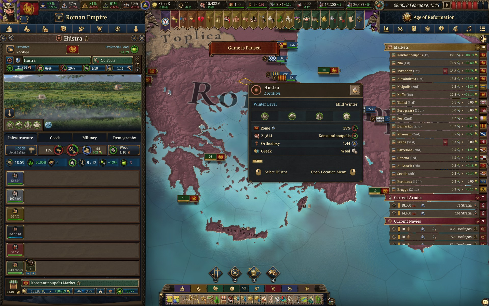
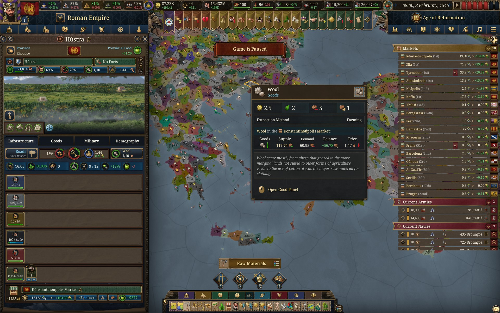
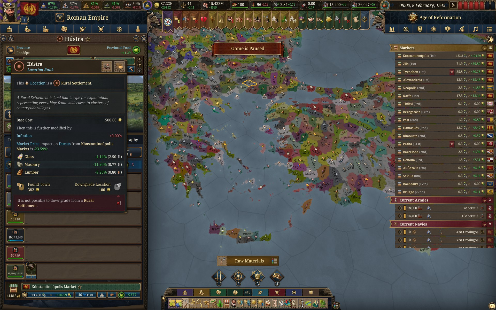
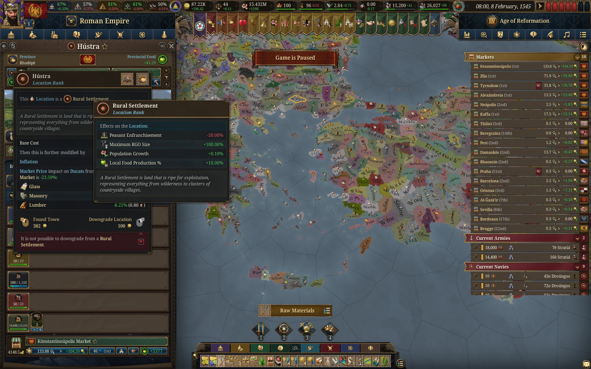
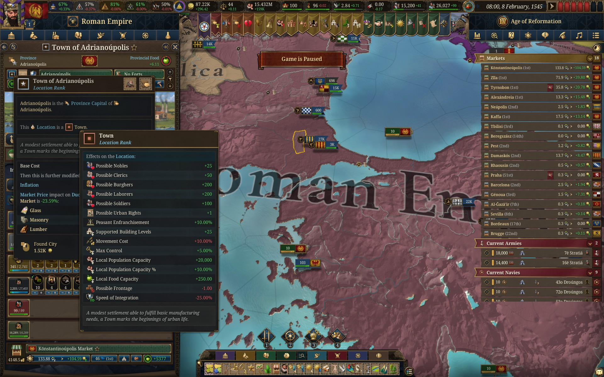
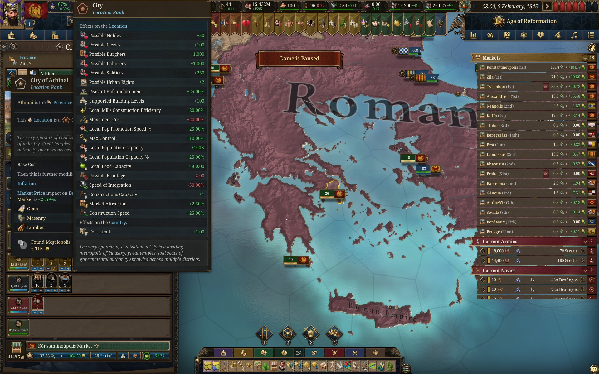

# Hidden in Plain Sight: Upgrading a Settlement in Europa Universalis V

I've been playing Europa Universalis V (EU5), a grand strategy game where you manage a country through its politics, economy, diplomacy, and military. For the history buffs who might look through and scrutinize my playthrough, yes, I managed to restore the Roman Empire as Byzantium. Anyway, one of the more important aspects of the game is developing your country's economy, especially when you're trying to sustain an empire of this caliber, among many other global powers.

After several playthroughs, I had become familiar with EU5's interface. There's an enormous amount of information on the screen, but eventually you learn to filter through the clutter and focus on what's important. However, even after becoming accustomed to the interface, I discovered that I had been overlooking an important feature for developing my economy.

Patches for the game get released regularly throughout the year, and there's no shortage of guides on YouTube or otherwise to understand even the smallest of changes and find out what is the META (Most Efficient Tactic Available). While looking for ways to scale my economy even further, I watched online that rural settlements could be manually upgraded into towns, and towns into cities, with the hard constraint of population size. This was exactly the sort of feature I was looking for. The problem was finding out how to actually do it.

I eventually had to search specifically for the settlement upgrade button online because the video I'd watched wasn't enough to help me locate it. It had taken me several playthroughs to discover an important economic function that had been available to me all along.

To demonstrate the problem, I chose Hústra, a rural settlement in the province of Rhodópē, within my restored Roman Empire.

Hústra was producing wool, which wasn't particularly valuable for my economic plans. I wanted to develop the settlement into a town, opening up opportunities for industry, additional buildings, and a more diverse population. Rural settlements receive bonuses to raw-material production, whereas towns can support 25 additional building levels and greater numbers of burghers and laborers. Cities expand these capabilities even further, supporting 100 additional building levels and much larger populations. My goal was to eventually broaden my empire's tax base rather than continue relying primarily on raw-material production.

To confirm what the settlement produced, I switched to the raw materials map.

This was one part of the interface that worked well. The map clearly distinguished different resources using colors, labels, and icons, allowing me to identify what each location produced without needing to inspect them individually.

Finding the settlement upgrade option, however, was another matter.

EU5 has an incredibly dense interface, with buttons, icons, statistics, and symbols competing for space. The option to upgrade Hústra wasn't presented as a clearly labeled action in the main province panel. Instead, it was tucked away behind a small, blue rounded square symbol representing the location's rank. Its appearance blended into the surrounding interface, making it easy to overlook among the other controls.

This illustrates a problem with **discoverability**, or how easily users can identify the actions available to them. What made this particularly frustrating was that I already knew the feature existed. I had read about it online, but still couldn't identify where to access it without searching for the exact button.

There's also an issue with **visual hierarchy**, which refers to how an interface uses size, contrast, and positioning to communicate the importance of its elements. Upgrading a settlement can have major economic consequences, yet the control responsible for accessing this functionality receives very little visual emphasis compared with the surrounding information.

Once I found the button, I encountered another problem. The panel displayed the cost of founding a town, but didn't clearly explain what I would gain from doing so.

I could hover over the rural settlement classification to open an additional tooltip, which described its current modifiers. These included increased population growth and local food production.

Although this information was useful, it didn't directly explain how those modifiers would change after upgrading to a town. I could see what I currently had, but not how it compared with what I was considering upgrading to.

To find out more, I could inspect an existing town elsewhere in my empire and hover over its location rank. For example, the tooltip for Adrianoúpolis showed that towns could support additional social classes, including burghers, laborers, and nobles, along with 25 additional building levels and increased population capacity.

The same process could be repeated for cities. Looking at Athínai, I could see that cities supported even more building levels and larger populations, along with additional bonuses such as increased local construction efficiency.

This relates to **recognition rather than recall**, a usability principle that encourages interfaces to present relevant information instead of requiring users to remember it. While EU5 does provide explanations for each settlement rank, the information is spread across separate tooltips. To compare the benefits of remaining a rural settlement against developing into a town, I would have to inspect the ranks individually and keep track of their differences rather than having them presented together when deciding whether to upgrade.

To be fair, EU5 is an extremely complex game, and its extensive use of tooltips has its uses. Once you understand where to look, they provide detailed explanations without requiring every piece of information to remain visible on the screen. The raw materials map is another example of the game successfully organizing a large amount of information into something useful.

However, I think the settlement upgrade interaction could be improved without adding much more clutter. The upgrade option could be placed more prominently alongside other settlement development controls. The upgrade tooltip could also provide a before-and-after comparison, showing the modifiers and opportunities that would change when founding a town.

What bothers me most about this experience is that I wasn't struggling to understand the game's economic mechanics. I knew what I wanted to accomplish and had even found information about the feature outside the game. Yet I still had to look up the exact location of a button that had been sitting in front of me for several playthroughs.

There's a difference between a game being complex and its interface making that complexity harder to manage. In this case, it's the latter.
